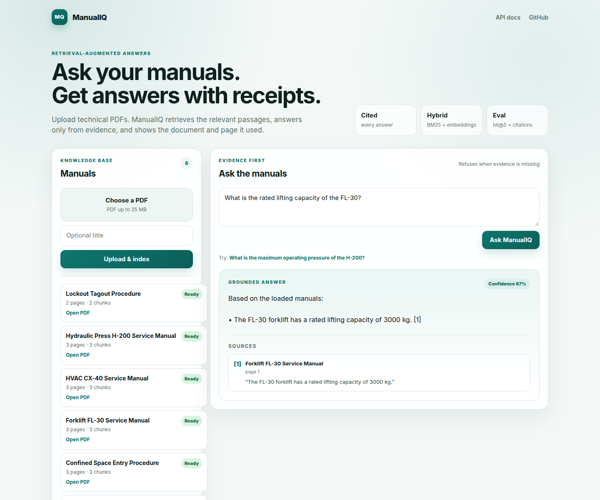
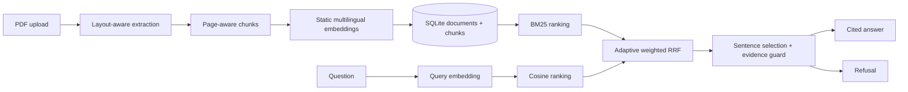

# ManualIQ

[](https://github.com/FerRobles616/manualiq/actions/workflows/ci.yml)
[](https://www.python.org/)
[](LICENSE)

**Grounded answers over technical manuals, with page-level citations and a refusal path.**



ManualIQ is a local-first retrieval-augmented generation (RAG) service for PDF manuals. Upload a
manual, ask a question, and get an answer built from the most relevant passages. Every answer shows
the document and page it came from. If the manuals do not contain enough evidence, ManualIQ refuses
instead of guessing.

The project is deliberately evaluation-first: the retrieval and grounding pipeline is measured with a
26-question dataset, and the same checks run in CI.

## Why this project

Most RAG demos stop at "the model answered something." ManualIQ focuses on the parts that make a RAG
system useful in a technical setting:

- **Citations with a page number** for every answer.
- **Citation links** open the original PDF at the cited page.
- **A refusal path** when the corpus has no evidence.
- **Hybrid retrieval** instead of a single embedding lookup.
- **A reproducible evaluation suite** with retrieval, citation, refusal, and support metrics.
- **No API key required** for the demo: the embedding model runs locally on CPU.

## Eval results

Full evaluation with the multilingual static embedding model
(`minishlab/potion-multilingual-128M`), 26 questions over 3 manuals (8 pages):

| Metric | Result |
| --- | ---: |
| hit@5 | **1.000** |
| MRR | **0.905** |
| Citation accuracy | **1.000** |
| Refusal accuracy | **1.000** |
| Answer rate (answerable questions) | **1.000** |
| Citation support | **1.000** |

- **21** questions are answerable from the corpus; **5** are out-of-domain and must be refused.
- Citation support checks that every quoted citation is an exact substring of the cited chunk.
- The full report is in [`backend/evals/runs/model2vec.json`](backend/evals/runs/model2vec.json).
- CI runs a smaller **smoke evaluation** with the deterministic lexical embedding provider, so CI
  never downloads the model and still exercises the whole pipeline.
- CI also builds and runs the Docker image (seed + health + query) and validates Alembic, seed, and
  the smoke evaluation against PostgreSQL.

See [`docs/evals.md`](docs/evals.md) for the methodology and per-question details.

### Local performance

Benchmark on the demo corpus with the multilingual model warmed up (21 questions × 5 runs, CPU):

| p50 | p95 | Mean | Marginal cost |
| ---: | ---: | ---: | ---: |
| 1.7 ms | 2.0 ms | 1.7 ms | **$0.00 / query** |

The measurement covers retrieval plus extractive answer selection. It excludes the one-time model
load on a cold process. Run it yourself with `make bench`; the raw report is
[`backend/evals/runs/benchmark.json`](backend/evals/runs/benchmark.json).

## How it works



1. **Ingestion**: PyMuPDF extracts text blocks page by page, keeping headings and wrapped paragraphs
   separate. The text is split into overlapping, page-aware chunks and embedded in batches.
2. **Retrieval**: BM25 and cosine similarity rank the chunks independently. An adaptive weighted RRF
   combines the rankings; BM25 gets more weight when it has a positive signal, while semantic-only
   questions fall back to vector ranking. Zero-score candidates are excluded.
3. **Answer selection**: The top three chunks are considered. The best sentence is selected using
   question intent cues (intervals, numeric specifications, reset steps, required PPE) plus lexical
   overlap. Only sentences with supporting evidence survive.
4. **Refusal**: A similarity threshold and an evidence guard reject questions whose key terms are not
   present in the candidate chunk, unless the semantic score is strong enough. Out-of-domain
   questions receive a refusal with no citations.
5. **Evaluation**: A CLI runs the dataset and writes a JSON report. CI runs the smoke subset with
   thresholds, so retrieval regressions fail the build.

## Quickstart

Requirements: Python 3.12+, a text-based PDF, about 1 GB of disk for the local embedding model, and
roughly 2 GB of RAM while the multilingual model is loaded. No API key is needed.

```bash
git clone https://github.com/FerRobles616/manualiq.git
cd manualiq

make install
cp backend/.env.example backend/.env
make migrate
make seed      # downloads the embedding model on first run and indexes the demo manuals
make run
```

Open <http://localhost:8000>. The demo corpus contains a hydraulic press manual, an HVAC manual, and a
lockout/tagout procedure.

Try the shareable answer URL:

```text
http://localhost:8000/?q=What%20is%20the%20maximum%20operating%20pressure%20of%20the%20H-200%3F
```

Or run the backend directly:

```bash
cd backend
python3 -m venv .venv
source .venv/bin/activate
pip install -e ".[dev]"
cp .env.example .env
alembic upgrade head
python -m scripts.seed_corpus
uvicorn app.main:app --reload
```

### Tests and evals

```bash
make test          # 19 unit and API tests
make lint          # ruff + mypy
make eval          # full 26-question evaluation
make eval-check    # fails if the full evaluation drops below thresholds
make bench         # local retrieval + answer latency benchmark
make smoke         # deterministic hash-embedding CI smoke eval
```

The Docker image includes the optional PostgreSQL driver. For a local PostgreSQL database, install
`pip install -e ".[dev,postgres]"` and set `DATABASE_URL` (see `backend/.env.example`).

## Deployment

A Render Blueprint is included in [`render.yaml`](render.yaml), with step-by-step notes in
[`docs/deploy.md`](docs/deploy.md). The free-tier blueprint uses the deterministic hash provider and
ephemeral SQLite: the multilingual model needs about 2 GB of RAM, and FieldOps already occupies the
account's single free PostgreSQL slot. The PostgreSQL path is CI-tested; set `DATABASE_URL` to a paid
or external Postgres for persistence. Run locally for semantic mode. Apply the Blueprint from the
Render dashboard; no secrets belong in the repository.

## API

Swagger UI: <http://localhost:8000/docs>

| Method | Path | Purpose |
| --- | --- | --- |
| `GET` | `/health` | Liveness check |
| `POST` | `/api/documents` | Upload and index a PDF (`file`, optional `title`) |
| `GET` | `/api/documents` | List indexed manuals |
| `GET` | `/api/documents/{id}` | Document metadata and chunk count |
| `GET` | `/api/documents/{id}/file` | Download the original PDF |
| `DELETE` | `/api/documents/{id}` | Remove a document and its chunks |
| `POST` | `/api/query` | JSON question → answer, citations, refusal, confidence |
| `POST` | `/query` | HTML partial for the HTMX UI |
| `GET` | `/?q=...` | Shareable, server-rendered answer |

Example:

```bash
curl -s http://localhost:8000/api/query \
  -H 'Content-Type: application/json' \
  -d '{"question":"How often should the hydraulic oil be changed?"}'
```

```json
{
  "answer": "Based on the loaded manuals:\n\n• Change the hydraulic oil every 500 operating hours. [1]",
  "citations": [
    {
      "document_id": "…",
      "document_title": "Hydraulic Press H-200 Service Manual",
      "page": 2,
      "chunk_id": "…",
      "quote": "Change the hydraulic oil every 500 operating hours."
    }
  ],
  "refused": false,
  "confidence": 0.447
}
```

## Project structure

```text
backend/
  app/
    api/routes/          FastAPI JSON and HTML/HTMX routes
    core/                Settings and environment configuration
    db/                  SQLAlchemy engine and session
    models/              Document and Chunk models
    schemas/             Pydantic request/response models
    services/
      ingestion.py       PDF extraction, page-aware chunking, embedding
      embeddings.py      model2vec + deterministic hash provider
      retrieval.py       BM25 + vector search + adaptive weighted RRF
      answering.py       Sentence selection, citations, refusal guard
      text.py            Tokenization, sentence splitting, chunking
    templates/           Jinja/HTMX UI
  data/corpus/           Three synthetic demo manuals
  evals/                 Full and smoke datasets + evaluation reports
  migrations/            Alembic migration
  scripts/               Corpus generation, seeding, evaluation, container start
  tests/                 Unit and API tests
render.yaml              Render Blueprint: Docker web service + PostgreSQL
docs/                    Architecture, evaluation, deployment, ADR, screenshots
```

## Design decisions

- **Extractive answers, not an unconstrained LLM.** Every statement is a sentence taken from a
  cited chunk. That makes citation support measurable and keeps the demo reproducible without an API
  key. A future LLM provider must return structured citations and pass the same grounding checks.
- **Static multilingual embeddings.** `model2vec` provides useful Spanish/English semantic retrieval
  on CPU without PyTorch or a GPU. The deterministic hash provider keeps CI fast and offline.
- **Hybrid retrieval.** BM25 is hard to beat for part numbers, error codes, and exact units. Vectors
  handle paraphrases. Weighted RRF lets both contribute without a learned reranker.
- **Local-first storage.** SQLite keeps the demo zero-dependency. Embeddings are JSON arrays and
  cosine similarity is computed in process. This is appropriate for a small manual corpus; pgvector
  with HNSW is the scaling path.
- **Evaluation as a product feature.** Thresholds in CI prevent silent retrieval regressions. The
  smoke set and the full model evaluation are deliberately separate.

More context: [`docs/architecture.md`](docs/architecture.md) and
[`docs/adr/001-hybrid-retrieval.md`](docs/adr/001-hybrid-retrieval.md).

## Limitations and roadmap

This is a portfolio v0.1, not a production document platform.

- The demo corpus is small (8 pages). The evaluation is designed to be honest, not exhaustive.
- The multilingual model needs about 2 GB of RAM; the free-tier deployment uses the lexical hash
  provider instead.
- Answers are extractive and single-evidence; multi-hop and conversational answers are future work.
- Ingestion is synchronous and text-PDF only. A background worker and OCR are next.
- Vector scoring is an in-process scan; pgvector/HNSW is the production upgrade.
- The public upload endpoint has no authentication or rate limiting; deploy it behind a demo gate.
- The free Render blueprint uses ephemeral SQLite; a persistent PostgreSQL deployment is the
  production path and is CI-tested.

Planned next steps: pgvector + Postgres, background ingestion jobs, an optional cited LLM answer
provider, OCR for scanned manuals, a 50+ question evaluation set, and a hosted demo.

## Stack

FastAPI · SQLAlchemy 2 · Alembic · Pydantic Settings · PyMuPDF · model2vec · rank-bm25 · NumPy ·
Jinja2 + HTMX · pytest · Ruff · mypy · GitHub Actions

## License

MIT. See [LICENSE](LICENSE).
