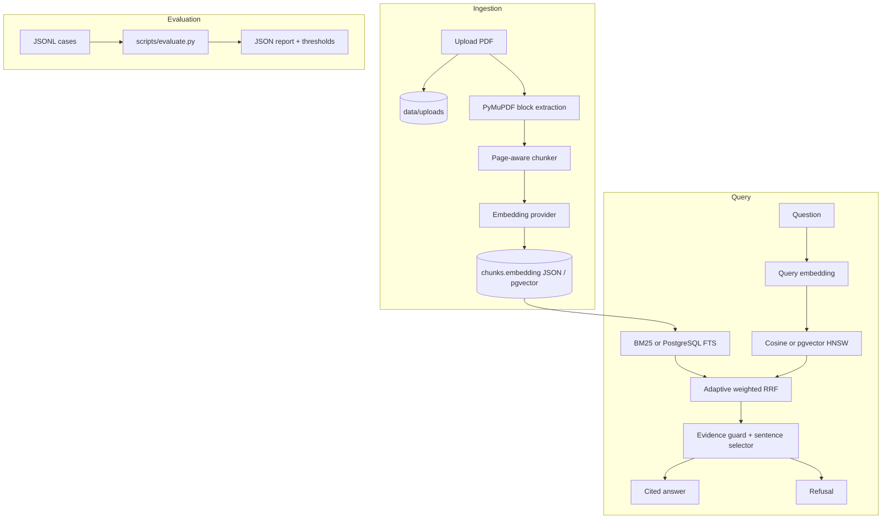

# Architecture

## Goals

ManualIQ answers questions over a small corpus of technical PDFs and makes the answer auditable. The
design optimizes for four things:

1. **Grounding** — every answer sentence comes from a cited chunk.
2. **Refusal** — no evidence means no answer.
3. **Local reproducibility** — no API key, GPU, or external vector database is required.
4. **Measurable quality** — retrieval, citations, and refusal behavior are tested in CI.

The current implementation is intentionally a single-process service. It is a portfolio v0.1, not a
multi-tenant document platform.

## Components



### Web/API layer

- `app/api/routes/documents.py` — PDF upload, listing, status, source download, deletion.
- `app/api/routes/query.py` — JSON `/api/query` and HTMX `/query` endpoints.
- `app/api/routes/ui.py` — server-rendered home page, upload form, shareable `/?q=...` answer URL.
- `app/main.py` — FastAPI app, CORS, static files, health check.

The UI is Jinja2 + HTMX. There is no separate frontend build. This keeps the demo a single deployable
service and keeps the API usable on its own.

### Persistence

`documents`:

- `id` (UUID), `title`, `filename`, `content_hash` (unique), `storage_path`
- `page_count`, `status` (`queued` / `processing` / `ready` / `failed`), `error`
- timestamps

`chunks`:

- `id` (UUID), `document_id`, `page`, `chunk_index`, `content`, `token_count`
- `embedding` as a JSON array of floats (both databases)
- `embedding_vec` as `vector(256)` on PostgreSQL, populated from the JSON embedding and indexed with
  HNSW cosine distance
- `created_at`

The content hash makes uploads idempotent: uploading the same PDF twice returns the existing document.

SQLite is the default for the local demo. On SQLite, vector search is an in-process NumPy scan over
the JSON arrays. On PostgreSQL, the app uses the native pgvector column and an HNSW index; the
migration creates the extension, backfills `embedding_vec`, and builds the index. The PostgreSQL path
is exercised by CI with the `pgvector/pgvector` image.

### Ingestion pipeline

1. Validate the PDF magic bytes and size.
2. Hash the file with SHA-256 and return an existing document for duplicates.
3. Extract page text with PyMuPDF using `get_text("blocks", sort=True)`. Lines inside a block are
   joined, so wrapped sentences stay intact; blocks remain separated by blank lines.
4. Split each page into chunks of at most `CHUNK_SIZE` characters with `CHUNK_OVERLAP` characters of
   overlap. The chunk keeps its 1-based page number.
5. Embed all chunks in batches of 32. Store one row per chunk. On PostgreSQL, also write the native
   `embedding_vec` column used by the HNSW index.
6. Mark the document `ready` with page count and chunk count, or `failed` with the error.

The extraction step is layout-aware rather than a full document-layout model: it preserves paragraph
and heading boundaries that PyMuPDF exposes, but it does not reconstruct tables, figures, or a
hierarchical section tree yet.

### Query pipeline

For a question `q` and corpus chunks `c_i`:

1. **Vector ranking.** Embed `q` with the same provider used at ingestion.
   - **SQLite:** L2-normalize query and JSON chunk vectors, then compute cosine similarity
     `s_i = q · c_i` in process. Negative and zero scores are excluded.
   - **PostgreSQL:** query `1 - (embedding_vec <=> query_vector)` with pgvector; an HNSW cosine index
     orders the candidates.
2. **Lexical ranking.**
   - **SQLite:** tokenize with lowercase Unicode words, remove English/Spanish stopwords, and build a
     `BM25Okapi` index.
   - **PostgreSQL:** use `to_tsvector`/`plainto_tsquery` and `ts_rank_cd`; the language is configurable
     with `FTS_LANGUAGE`.
   Positive scores form the second ranking in both paths.
3. **Adaptive weighted RRF.** With rank constant `k = 60`:

   ```text
   score(c) = Σ  weight_r / (k + rank_r(c) + 1)
   ```

   When the lexical ranking has any positive score, `weight_lexical = 1.0` and `weight_vector = 0.7`.
   When lexical search has no signal, only the vector ranking contributes (`weight_vector = 1.0`).
   This gives exact part numbers, error codes, units, and interval terms a stronger voice without
   losing paraphrases.
4. **Sentence selection.** Consider the top three fused chunks. For each chunk:
   - reject chunks below `MIN_SIMILARITY`;
   - extract sentences (sentence punctuation or block boundaries);
   - keep only sentences that end with sentence punctuation (this filters headings and section
     labels);
   - score sentences by token overlap with the question;
   - add intent bonuses for time units ("every 500 hours"), reset steps, first/before steps, roles,
     required PPE, and numeric units (pressure, voltage, torque, charge, airflow).
5. **Evidence guard.** Remove generic question words (`reset`, `replace`, `check`, `how`, `often`,
   etc.) from the question. If none of the remaining specific terms occur in the candidate chunk, the
   chunk is only accepted when its vector score is at least `1.5 × MIN_SIMILARITY`. This prevents a
   generic verb such as "reset" from turning an unrelated email-password question into an HVAC
   answer.
6. **Answer.** Return one sentence with one citation: document title, page, chunk id, and exact quote.
   If no candidate survives, return a refusal with no citations.

The answer is deliberately single-evidence. It is precise for the evaluation's factual questions and
simple to audit. Multi-evidence synthesis is a later feature.

## Evaluation architecture

`scripts/evaluate.py` loads JSONL cases, runs the same retrieval and answer services used by the API,
and computes:

- hit@k and MRR from gold document/page labels;
- citation accuracy from the first citation;
- refusal accuracy from answerable/unanswerable labels;
- citation support by checking each quote is a substring of the cited chunk.

The full run uses the multilingual model on SQLite. CI uses the deterministic hash provider and a
smaller smoke set against PostgreSQL/pgvector with explicit thresholds. The evaluation report is
written to `evals/runs/` as JSON.

## Failure modes and trade-offs

- **One page is one chunk in the demo corpus.** This keeps citations easy to validate, but a dense
  page could contain many facts and retrieval competes at page granularity. Production should chunk
  by section and keep page metadata.
- **SQLite in-process scan.** O(n) per query and memory proportional to the corpus on SQLite. The
  PostgreSQL path uses pgvector/HNSW and is the scaling path; the free demo stays on SQLite.
- **Extractive answers.** High faithfulness, limited fluency and no multi-sentence synthesis. An LLM
  can be added later only if it returns structured citations that pass the same support checks.
- **Synchronous ingestion.** Small PDFs index in seconds; a queue/worker is needed for large uploads
  and concurrency.
- **No authentication or rate limiting.** The upload endpoint is a demo surface. A hosted deployment
  needs an admin token or login, size limits at the edge, and per-IP rate limiting.
- **Text PDFs only.** Scanned PDFs need OCR before extraction.

## Scaling path

1. Benchmark pgvector/HNSW against the SQLite scan on a larger corpus and tune HNSW parameters.
2. Add a durable ingestion worker and a `jobs` table with claim semantics.
3. Add section-aware chunking and document metadata (revision, equipment, language).
4. Expand the gold set beyond 60 cases and add a human review pass.
5. Add an optional LLM answer provider with a strict citation/refusal contract and the same eval gates.
6. Add OCR, auth, rate limiting, and a persistent hosted deployment.
